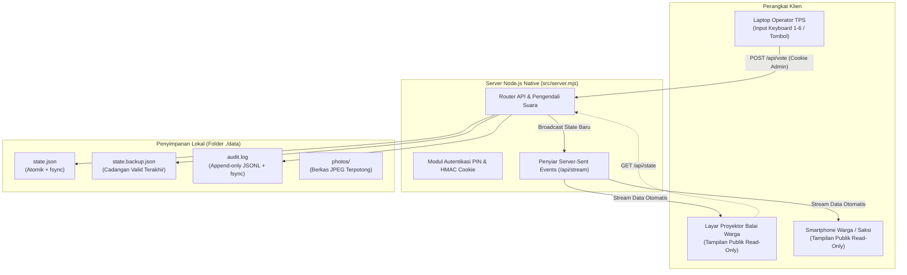
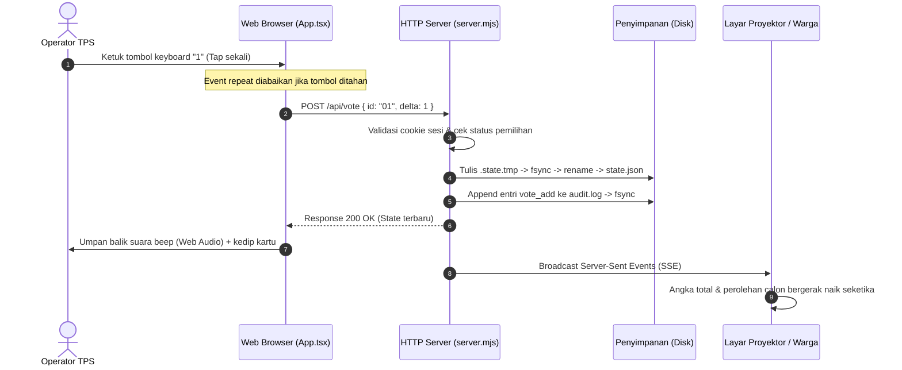

# Papan Hitung Suara Pemilihan RT

Papan hitung suara digital luring (*offline-first digital tally board*) untuk pemilihan Ketua RT / RW di TPS. Dirancang khusus untuk pemilihan fisik di mana surat suara dicoblos di bilik, dihitung secara terbuka oleh panitia, dan dicatat langsung ke layar proyektor balai warga serta ponsel warga secara *real-time* via Server-Sent Events (SSE).

Sistem ini tahan mati lampu, memiliki jejak audit lengkap (*audit trail*), serta dilengkapi pengaman papan ketik agar penekanan tombol tidak sengaja tertahan (*anti-hold*).

---

## Daftar Isi
- [Keunggulan Sistem](#keunggulan-sistem)
- [Arsitektur & Alur Kerja](#arsitektur--alur-kerja)
- [Struktur Repositori](#struktur-repositori)
- [Kebutuhan Sistem](#kebutuhan-sistem)
- [Panduan Instalasi & Menjalankan](#panduan-instalasi--menjalankan)
  - [Mode Pengembang (Development)](#1-mode-pengembang-development)
  - [Mode Produksi Lokal](#2-mode-produksi-lokal)
  - [Menggunakan Docker (Direkomendasikan di TPS)](#3-menggunakan-docker-direkomendasikan-di-tps)
- [Panduan Penggunaan Operator TPS](#panduan-penggunaan-operator-tps)
- [Penyimpanan Data & Ketahanan Mati Lampu](#penyimpanan-data--ketahanan-mati-lampu)
- [Log Aktivitas & Audit Trail](#log-aktivitas--audit-trail)
- [Dokumentasi API](#dokumentasi-api)
- [Variabel Lingkungan (Environment Variables)](#variabel-lingkungan-environment-variables)
- [Pengujian Otomatis](#pengujian-otomatis)

---

## Keunggulan Sistem

1. **Sinkronisasi Real-Time Ringan (SSE)**: Hasil coblosan diperbarui seketika ke seluruh perangkat yang terhubung (proyektor, laptop saksi, HP warga) tanpa membebani jaringan dan tanpa perlu memasang framework WebSocket berat.
2. **Tahan Mati Lampu & Pemulihan Otomatis**: Setiap suara tersimpan ke disk melalui penulisan berkas atomik (`tmp` + `fsync` + `rename` + `syncDir`). Dilengkapi cadangan otomatis (`state.backup.json`) dan mekanisme *self-healing* yang memulihkan data bila server mati mendadak saat proses penulisan.
3. **Log Audit Lengkap (Khusus Operator)**: Mencatat penambahan suara (`vote_add`), pengurangan manual (`vote_subtract`), pembatalan (*undo*), reset, hingga perubahan nama dan foto calon ke berkas `data/audit.log` (*append-only* JSONL dengan `fsync`). Riwayat audit dapat difilter dan diunduh langsung dari dashboard.
4. **Deteksi Mati Listrik Mendadak**: Server mencatat sesi mulai dan berhenti. Jika server mati tidak wajar (misal listrik padam atau mesin mati paksa), sesi berikutnya memunculkan penanda peringatan kejadian terakhir sebelum padam.
5. **Anti-Hold Keyboard (Wajib Tap-Tap)**: Penekanan tombol angka keyboard `1`–`6` mengabaikan *auto-repeat* peramban. Tombol yang tidak sengaja tertindih tidak akan menambah suara beruntun; operator wajib mengetuk ulang untuk tiap surat suara.
6. **Pemotong Foto Interaktif & Fleksibilitas Rasio**: Unggah foto calon dengan dialog crop interaktif (`react-easy-crop`), pilihan rasio aspek **4:3 (Lanskap)**, **1:1 (Persegi/Pas Foto)**, atau **3:4 (Potret)**, zoom slider, serta tombol ganti rasio cepat di kartu. Foto kartu tampil *full-bleed* di bagian atas.
7. **Panel Manajemen Lengkap di Dashboard**: Operator ber-PIN dapat mengubah nama calon, menambah calon (maks 12), menghapus calon, mengganti/menghapus foto, serta mengubah judul, subjudul, dan tanggal pemilihan langsung tanpa menyentuh file server.
8. **Konsumsi Memori Sangat Hemat**: Backend Node.js native ESM (`node:http`) tanpa dependency server eksternal, memori RAM hanya ~25–30 MB, image Docker alpine multi-stage (~60 MB). Cocok dijalankan pada laptop lawas, mini PC, Raspberry Pi, maupun VPS minim.

---

## Arsitektur & Alur Kerja



### Alur Pencatatan Satu Surat Suara:


---

## Struktur Repositori

```text
pemilihan-rt/
├── data/                    # Folder data persisten (diabaikan dari git)
│   ├── audit.log            # Log audit append-only (JSONL)
│   ├── photos/              # Berkas foto calon hasil unggahan
│   ├── state.backup.json    # Cadangan state satu versi sebelumnya
│   └── state.json           # Berkas state utama penghitungan suara
├── public/                  # Aset statis peramban
│   ├── candidates/          # Foto calon bawaan (contoh 01.jpg - 06.jpg)
│   └── favicon.svg          # Ikon situs pemilihan
├── scripts/
│   ├── crash-test.mjs       # Uji ketahanan mati paksa (SIGKILL) & pemulihan
│   └── e2e.mjs              # Rangkaian uji otomatis end-to-end API
├── src/
│   ├── components/ui/       # Komponen antarmuka bergaya shadcn/ui (Tailwind)
│   ├── lib/
│   │   ├── api.ts           # Definisi tipe TypeScript & fungsi pemanggil API
│   │   └── utils.ts         # Utilitas penggabungan kelas Tailwind
│   ├── App.tsx              # Antarmuka utama dashboard & panel operator
│   ├── main.tsx             # Entry point React 19
│   └── server.mjs           # Server native Node.js (SSE, API, file server, audit)
├── candidates.json          # Konfigurasi data awal calon & info pemilihan
├── docker-compose.yml       # Konfigurasi deployment kontainer Docker
├── Dockerfile               # Multi-stage build (Node 22 Alpine, ramah memori)
├── package.json             # Skrip eksekusi & dependensi proyek
├── server.mjs               # Entry point root server (delegasi ke src/server.mjs)
└── vite.config.ts           # Konfigurasi bundler Vite 6 & Tailwind CSS v4
```

---

## Kebutuhan Sistem

- **Node.js**: Versi 20 LTS atau 22 LTS ke atas.
- **Sistem Operasi**: Linux, macOS, atau Windows.
- **Opsional**: Docker & Docker Compose (bila ingin menjalankan via kontainer).

---

## Panduan Instalasi & Menjalankan

### 1. Mode Pengembang (Development)
Cocok untuk pengembangan dan uji coba fitur lokal:

```bash
# 1. Pasang dependensi
npm install

# 2. Jalankan server backend (terminal 1)
npm start

# 3. Jalankan server Vite frontend (terminal 2)
npm run dev
```
Buka peramban di `http://localhost:5173`. Semua panggilan API otomatis di-proxy ke port `8787`.

---

### 2. Mode Produksi Lokal
Cocok untuk dijalankan langsung di laptop operator TPS:

```bash
# 1. Kompilasi aset frontend
npm run build

# 2. Jalankan server produksi
npm start
```
Buka peramban di `http://localhost:8787`.

Untuk mengubah PIN operator atau port, jalankan dengan variabel lingkungan:
```bash
# Linux / macOS
ADMIN_PIN=654321 PORT=8080 npm start

# Windows (PowerShell)
$env:ADMIN_PIN="654321"; $env:PORT="8080"; npm start
```

---

### 3. Menggunakan Docker (Direkomendasikan di TPS / VPS)
Berkas `Dockerfile`, `docker-compose.yml`, `.dockerignore`, dan `docker-entrypoint.sh` sudah disertakan di repositori, sehingga deployment cukup dengan *pull* lalu *build*:

```bash
# 1. Ambil repositori
git clone https://github.com/ROYALXYZ/pemilihan-ketuart.git
cd pemilihan-ketuart

# 2. Siapkan konfigurasi (ganti PIN sebelum pemilihan)
cp .env.example .env
nano .env   # isi ADMIN_PIN dan SESSION_SECRET

# 3. Bangun dan jalankan kontainer
docker compose up -d --build
```

Aplikasi dapat diakses di `http://localhost:8787` (atau `http://IP-VPS:8787` bila dijalankan di VPS).

Catatan penting:
- Folder `./data` otomatis terpasang ke `/data` di dalam kontainer, sehingga suara, foto, dan log audit tetap tersimpan di host meski kontainer dihentikan atau dibuat ulang.
- Container berjalan sebagai pengguna non-root `node` (uid 1000). `docker-entrypoint.sh` otomatis menyiapkan dan memperbaiki izin `/data` saat kontainer start sebagai root, jadi tidak perlu `chown` manual meskipun folder `data/` hasil `git clone` dimiliki root.
- Bila VPS memakai firewall, buka port `8787` (atau arahkan reverse proxy Nginx/Caddy ke port tersebut).

Untuk menghentikan:
```bash
docker compose down
# PENTING: Jangan gunakan flag -v agar volume data tidak terhapus!
```

---

## Panduan Penggunaan Operator TPS

### A. Masuk ke Panel Operator
1. Buka dashboard di peramban `http://localhost:8787`.
2. Klik tombol **Masuk Operator** di pojok kanan atas.
3. Masukkan PIN panitia (bawaan: `123456`, dapat diatur via variabel `ADMIN_PIN`).
4. Setelah berhasil, spanduk hijau **Panel Input Operator TPS** dan tombol kontrol akan muncul.

### B. Mencatat Perolehan Suara
- **Menggunakan Keyboard**: Tekan tombol angka `1` sampai `6` pada keyboard laptop sesuai nomor urut calon.
  - **Sistem Anti-Hold**: Tombol tidak bisa ditahan. Bila tombol ditekan terus, suara **hanya bertambah 1 kali**. Operator wajib melepas tombol dan menekannya lagi (*tap-tap*) untuk tiap surat suara berikutnya.
- **Menggunakan Tombol di Layar**: Klik tombol hijau **+1 Suara** pada kartu calon bersangkutan.

### C. Mengoreksi Kesalahan Input Suara
- **Tombol Kurang (`−1`)**: Pada kartu calon yang salah diinput, klik tombol **−1** untuk mengurangi 1 suara dari calon tersebut. Aksi ini tercatat di audit sebagai `vote_subtract`.
- **Tombol Undo**: Klik tombol **Batalkan Terakhir (Undo)** atau tekan tombol **Backspace** / **Ctrl+Z** pada keyboard untuk membatalkan suara terakhir yang masuk.

### D. Mengatur Calon & Info Pemilihan Langsung di Layar
- **Ganti / Potong Foto**: Klik **Ganti Foto** atau **Unggah Foto** pada kartu calon. Pilih file foto wajah, atur rasio (**4:3 Lanskap**, **1:1 Persegi/Pas Foto**, atau **3:4 Potret**), geser titik fokus crop, dan atur perbesaran (*zoom*).
- **Atur Potongan Cepat**: Klik tombol rasio **4:3 / 1:1 / 3:4** di bawah kartu calon untuk mengubah rasio bingkai tampilan kartu secara instan, atau klik **Atur Potongan** untuk memotong ulang foto yang sudah ada.
- **Ubah Nama Calon**: Klik tombol **Ubah Nama** pada kartu calon.
- **Tambah Calon Baru**: Klik tombol **+ Tambah Calon** di atas daftar calon (maksimal 12 calon).
- **Hapus Calon**: Buka dialog ubah calon, lalu klik **Hapus Calon**.
- **Ubah Judul Pemilihan**: Klik **Ubah Informasi Pemilihan** pada panel operator untuk mengganti Judul, Subjudul RT/RW/Kelurahan, dan Tanggal Pemilihan tanpa menyentuh file konfigurasi.

### E. Membaca Log Aktivitas & Mengakhiri Pemilihan
1. **Melihat Log**: Klik tombol **Log Aktivitas** pada panel operator. Di sini terlihat urutan detik demi detik kapan suara ditambah atau dikurangi, total suara setelahnya, hingga kejadian restart server.
2. **Unduh Arsip**: Klik **Unduh JSONL** di dalam dialog log untuk menyimpan berkas bukti audit sebagai arsip fisik panitia/saksi.
3. **Kunci Hasil**: Setelah seluruh surat suara selesai dihitung, klik tombol **Kunci Penghitungan**. Status pemilihan berubah menjadi *Selesai / Terkunci*, dan tombol suara dinonaktifkan untuk mencegah penambahan tak sengaja.

---

## Penyimpanan Data & Ketahanan Mati Lampu

Aplikasi ini sengaja **tidak memakai database berat** agar hemat RAM dan mudah dipindahkan. Mekanisme durabilitas yang diterapkan:

1. **Penulisan Atomik (`Atomic Write`)**:
   Setiap kali suara dicatat, server menulis seluruh state ke berkas sementara `.state.<uuid>.tmp`, menjalankan `fsync` agar data tertulis ke piringan disk (bukan hanya cache memori OS), lalu mengganti nama berkas secara atomik ke `data/state.json`.
2. **Sinkronisasi Direktori (POSIX `syncDir`)**:
   Pada sistem Linux / Docker, direktori induk juga di-*flush* dengan `fsync` agar entri nama berkas tetap durable meski listrik padam seketika.
3. **Cadangan Otomatis Generasi Sebelumnya (`data/state.backup.json`)**:
   Sebelum state baru ditimpa, versi valid sebelumnya dicadangkan. Jika saat listrik padam berkas utama terpotong, server otomatis memulihkan diri dari berkas cadangan ini saat menyala kembali.
4. **Pencegahan Berkas Rusak**:
   Bila berkas utama rusak parah, server memindahkannya ke `state.rusak.<timestamp>.json` dan tetap hidup menggunakan cadangan terakhir atau konfigurasi awal, sehingga proses pemilihan tidak terhenti total.
5. **Penyimpanan Foto Atomik**:
   Berkas foto di `data/photos/` ditulis dengan pola penulisan sementara atomik yang sama.

> **Tips Keamanan Data di Lapangan:**
> Selalu pertahankan volume folder `./data`. Salin folder `data/` ke flashdisk secara berkala setelah penghitungan selesai sebagai cadangan luar mesin.

---

## Log Aktivitas & Audit Trail

Berkas log audit disimpan di `data/audit.log` dengan format JSONL (*append-only* dengan `fsync` per baris):

```json
{"seq":1,"at":1761974400000,"action":"server_start","total":0,"candidates":6,"note":""}
{"seq":2,"at":1761974415200,"action":"vote_add","candidateId":"01","candidateName":"Budi Santoso","votesAfter":1,"totalAfter":1,"ip":"::1"}
{"seq":3,"at":1761974421100,"action":"vote_subtract","candidateId":"01","candidateName":"Budi Santoso","votesAfter":0,"totalAfter":0,"ip":"::1"}
{"seq":4,"at":1761974430000,"action":"undo","candidateId":"02","candidateName":"Siti Rahmawati","votesAfter":0,"totalAfter":0}
{"seq":5,"at":1761974440000,"action":"status_lock","previous":"open","total":45}
```

### Arti Aksi pada Log:
- `server_start`: Server dinyalakan. Memuat total suara saat boot dan mendeteksi jika sesi sebelumnya mati mendadak.
- `server_stop`: Server dimatikan secara normal (`SIGINT` / `SIGTERM`).
- `vote_add`: Penambahan 1 suara pada calon.
- `vote_subtract`: Pengurangan 1 suara manual pada calon.
- `undo`: Pembatalan suara terakhir yang masuk.
- `reset`: Pengosongan perolehan suara menjadi 0.
- `status_lock` / `status_unlock`: Penguncian atau pembukaan kembali proses hitung.
- `candidate_add` / `candidate_remove` / `candidate_rename`: Pengelolaan data calon.
- `photo_set` / `photo_remove` / `photo_ratio`: Perubahan foto atau rasio foto calon.
- `election_update`: Perubahan judul, subjudul, atau tanggal pemilihan.

---

## Dokumentasi API

Seluruh endpoint berada di bawah awalan `/api`. Endpoint publik dapat diakses tanpa login; endpoint berlabel **Admin** memerlukan cookie sesi dari `/api/login`.

### Endpoint Publik
- `GET /api/state`: Mengambil kondisi penghitungan suara saat ini (calon, total suara, persentase, status, update terakhir).
- `GET /api/stream`: Membuka koneksi Server-Sent Events (SSE) untuk menerima pembaruan state secara langsung.
- `GET /api/session`: Memeriksa apakah peramban saat ini terautentikasi sebagai operator (`{ admin: boolean }`).
- `POST /api/login`: Masuk operator dengan PIN (`{ pin: string }`). Mengembalikan cookie `session`. Maksimal 8 percobaan per menit per alamat IP.
- `POST /api/logout`: Menghapus sesi operator dan membersihkan cookie.

### Endpoint Khusus Operator (Admin)
- `GET /api/audit?limit=200`: Membaca riwayat audit log terbaru (maksimal 500 entri).
- `POST /api/vote`: Menambah atau mengurangi suara (`{ id: string, delta: 1 | -1 }`). Ditolak jika status terkunci atau suara calon bernilai di bawah nol.
- `POST /api/undo`: Membatalkan suara terakhir yang masuk.
- `POST /api/photo`: Mengunggah foto hasil pemotongan (`{ id: string, data: "data:image/jpeg;base64,...", ratio: "landscape" | "square" | "portrait" }`). Maksimal ukuran 1,5 MB.
- `POST /api/photo/ratio`: Mengubah rasio kartu foto (`{ id: string, ratio: "landscape" | "square" | "portrait" }`).
- `POST /api/photo/remove`: Menghapus foto calon (`{ id: string }`).
- `POST /api/candidate`: Mengubah nama calon (`{ id: string, name: string }`).
- `POST /api/candidate/add`: Menambah calon baru (`{ name: string }`). Maksimal 12 calon.
- `POST /api/candidate/remove`: Menghapus calon (`{ id: string }`). Minimal 1 calon tersisa.
- `POST /api/election`: Mengubah informasi pemilihan (`{ title: string, subtitle: string, date: "YYYY-MM-DD" }`).
- `POST /api/status`: Mengunci atau membuka penghitungan (`{ status: "open" | "closed" }`).
- `POST /api/reset`: Mereset perolehan suara seluruh calon ke 0 (`{ confirm: "RESET" }`). Log audit tidak ikut terhapus.

---

## Variabel Lingkungan (Environment Variables)

Aplikasi dapat dikonfigurasi menggunakan variabel lingkungan sistem atau file environment Docker:

| Variabel | Bawaan | Keterangan |
| :--- | :--- | :--- |
| `PORT` | `8787` | Port HTTP yang digunakan server |
| `ADMIN_PIN` | `123456` | PIN angka untuk login operator panel TPS |
| `DATA_DIR` | `./data` | Lokasi folder penyimpanan state, foto, dan audit log |
| `SESSION_SECRET` | *(Random 32 bytes)* | Kunci enkripsi tanda tangan cookie sesi HMAC-SHA256. Isi nilai tetap agar sesi operator tidak hilang saat kontainer restart |
| `TZ` | `Asia/Jakarta` | Zona waktu kontainer (dipakai pada `docker-compose.yml`) |
| `NODE_ENV` | `development` | Disetel ke `production` pada image kontainer Docker |

Pada deployment Docker, semua variabel di atas dapat diatur lewat berkas `.env` di samping `docker-compose.yml` (lihat `.env.example`).

---

## Pengujian Otomatis

Aplikasi ini dilengkapi pengujian menyeluruh berbasis Node.js native tanpa ketergantungan library luar:

```bash
# 1. Jalankan pengujian end-to-end API (42 assertion lengkap)
npm run test:e2e

# 2. Jalankan simulasi uji ketahanan mati lampu / crash test
npm run test:crash

# 3. Uji kompilasi kode frontend TypeScript & Vite
npm run build
```

Semua pengujian memastikan bahwa integritas data suara, autentikasi PIN, pencegahan auto-repeat keyboard, pemulihan crash berkas rusak, dan log audit berfungsi normal sebelum diaplikasikan di lapangan.
